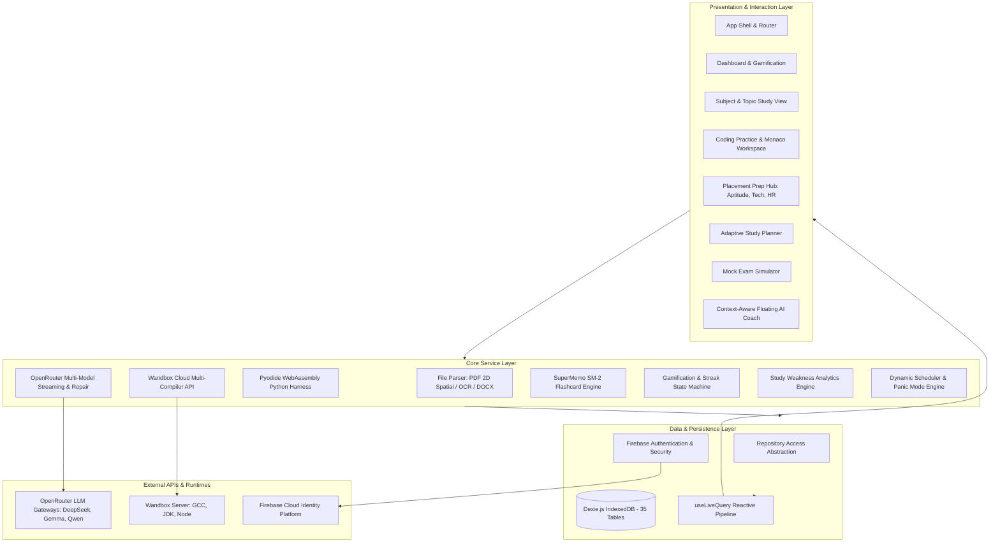

# STUDYMAPPER — COMPLETE TECHNICAL ARCHITECTURE & SYSTEM DOCUMENTATION

> **Project Name:** StudyMapper  
> **Document Type:** Comprehensive Technical Specification & Documentation Review Master Document  
> **Target Audience:** Technical Evaluators, Project Reviewers, Viva Voce Committees, Software Architects, and Engineering Leads  
> **Date:** September 2026  
> **Repository:** `StudyMapper`  
> **Platform Version:** 1.0.0 (Production Architecture)  

---

## TABLE OF CONTENTS
1. [Executive Summary & System Philosophy](#1-executive-summary--system-philosophy)
2. [Complete Technology Stack Specification](#2-complete-technology-stack-specification)
3. [System Architecture & Data Flow](#3-system-architecture--data-flow)
4. [IndexedDB Schema & Data Models (Dexie.js v17)](#4-indexeddb-schema--data-models-dexiejs-v17)
5. [Core Functional Modules Deep Dive](#5-core-functional-modules-deep-dive)
   - [5.1 Document Ingestion, Spatial Parsing & OCR Pipeline](#51-document-ingestion-spatial-parsing--ocr-pipeline)
   - [5.2 Pedagogical Notes Generation & Multimodal Study Tools](#52-pedagogical-notes-generation--multimodal-study-tools)
   - [5.3 Spaced Repetition System (SRS) Flashcards Engine](#53-spaced-repetition-system-srs-flashcards-engine)
   - [5.4 Question Bank & Mock Exam Simulator with Variant Generation](#54-question-bank--mock-exam-simulator-with-variant-generation)
   - [5.5 Career Skill Roadmaps & Dynamic Pathways](#55-career-skill-roadmaps--dynamic-pathways)
   - [5.6 Placement Preparation Suite (Aptitude, Technical & HR)](#56-placement-preparation-suite-aptitude-technical--hr)
   - [5.7 Interactive Coding Practice & In-Browser Execution Engine](#57-interactive-coding-practice--in-browser-execution-engine)
   - [5.8 Adaptive Study Planner & Algorithmic Panic Mode](#58-adaptive-study-planner--algorithmic-panic-mode)
   - [5.9 Gamification, XP Engine & Behavior Conditioning](#59-gamification-xp-engine--behavior-conditioning)
   - [5.10 Context-Aware Floating AI Coach & Morning Digest](#510-context-aware-floating-ai-coach--morning-digest)
   - [5.11 Enterprise Compliance, Legal & Resilience Engineering](#511-enterprise-compliance-legal--resilience-engineering)
6. [AI Engineering: Streaming Resilience & Fallback Chains](#6-ai-engineering-streaming-resilience--fallback-chains)
7. [Repository File & Directory Structure](#7-repository-file--directory-structure)
8. [Installation, Configuration & Deployment Guide](#8-installation-configuration--deployment-guide)
9. [Documentation Review & Viva Voce Q&A Cheat Sheet](#9-documentation-review--viva-voce-qa-cheat-sheet)

---

## 1. EXECUTIVE SUMMARY & SYSTEM PHILOSOPHY

### 1.1 Overview
**StudyMapper** is a local-first, AI-augmented educational operating system engineered for engineering students, developers, and competitive exam candidates. It unifies syllabus ingestion, structured conceptual learning, spaced repetition flashcards, mock examinations, an interactive multi-language coding sandbox, career skill roadmapping, and an interview preparation suite into a single reactive Web application.

### 1.2 Core Architectural Principles
1. **Local-First & Offline-Capable:** Unlike cloud-dependent educational tools that lock user data behind servers, StudyMapper stores all subjects, units, notes, code solutions, flashcard intervals, and exam histories locally in browser storage using **IndexedDB (via Dexie.js)**. The system remains 100% operational offline for reviewing, note-taking, and local Python execution.
2. **Resilient AI Pipeline with Zero-Downtime Fallback:** Large Language Model (LLM) calls route through an OpenRouter cascading fallback chain. If a primary free model experiences high traffic, rate limiting, or context cutoffs, the engine transparently switches down the fallback chain without breaking user workflow.
3. **Safe In-Browser Execution:** Rather than running expensive, high-latency remote Docker containers for code evaluation, StudyMapper runs Python directly on the user's CPU using **WebAssembly (Pyodide)**, backed by Wandbox compilation APIs for compiled languages (C, C++, Java).
4. **Cognitive Science Backing:** Learning features are grounded in proven educational psychology paradigms:
   - **Bloom's Revised Taxonomy:** Multi-level learning from factual knowledge to architectural design.
   - **SuperMemo SM-2 Algorithm:** Mathematically optimized flashcard intervals based on recall effort.
   - **Pomodoro Technique:** Focus intervals coupled with session duration analytics.
   - **STAR Method:** Behavioral interview scoring (Situation, Task, Action, Result).
   - **Cognitive Load Theory:** Visual split-screen workspaces, interactive Mermaid concept maps, and progressive disclosure of hints.

---

## 2. COMPLETE TECHNOLOGY STACK SPECIFICATION

| Category | Technology / Library | Version | Functional Purpose |
|---|---|---|---|
| **Core Framework** | [React](https://react.dev/) | `^19.2.7` | UI component tree, state synchronization, hooks architecture |
| **DOM Renderer** | [ReactDOM](https://react.dev/) | `^19.2.7` | Browser virtual DOM reconciliation |
| **Bundler & Dev Server** | [Vite](https://vitejs.dev/) | `^8.1.1` | ESM lightning-fast HMR and production roll-up bundling |
| **Client Routing** | [React Router DOM](https://reactrouter.com/) | `^7.18.1` | Client-side routing, URL state management, nested dynamic layouts |
| **Database & Persistence** | [Dexie.js](https://dexie.org/) | `^4.4.4` | IndexedDB wrapper with promise-based schema definition and migrations |
| **Reactive DB Hooks** | [dexie-react-hooks](https://dexie.org/docs/dexie-react-hooks/) | `^4.4.0` | `useLiveQuery` hook for real-time UI re-renders on DB mutations |
| **Cloud Authentication** | [Firebase](https://firebase.google.com/) | `^12.17.1` | Google OAuth, Email/Password, and Phone OTP with invisible reCAPTCHA |
| **In-Browser Code Editor** | [@monaco-editor/react](https://github.com/suren-atoyan/monaco-react) | `^4.7.0` | VS Code-grade code editor with syntax highlighting, line numbers, and shortcuts |
| **Client Python Wasm Runtime** | [Pyodide](https://pyodide.org/) | `^314.0.6` | Full Python runtime compiled to WebAssembly running inside browser sandbox |
| **External Compilers** | [Wandbox API](https://wandbox.org/) | REST | Cloud compilation and execution engine for C, C++, Java, and Node.js |
| **Document Parsing (PDF)** | [pdfjs-dist](https://mozilla.github.io/pdf.js/) | `^6.1.200` | Mozilla PDF rendering engine with custom spatial coordinate sorting |
| **Client OCR Engine** | [Tesseract.js](https://tesseract.projectnaptha.com/) | `^7.0.0` | Pure client-side Optical Character Recognition on image uploads |
| **Document Parsing (Word)**| [Mammoth](https://github.com/mwilliamson/mammoth.js) | `^1.12.0` | Extraction of clean markdown text from `.docx` files |
| **Markdown Rendering** | [react-markdown](https://github.com/remarkjs/react-markdown) | `^10.1.0` | React component for rendering parsed Markdown |
| **GitHub Flavored Markdown**| [remark-gfm](https://github.com/remarkjs/remark-gfm) | `^4.0.1` | Support for tables, task lists, strikethrough, and autolinks |
| **Mathematical Typesetting**| [KaTeX](https://katex.org/) | `^0.18.2` | Ultra-fast LaTeX mathematical formula rendering |
| **KaTeX Markdown Bridge** | [remark-math](https://github.com/remarkjs/remark-math) & [rehype-katex](https://github.com/remarkjs/rehype-katex) | `^6.0.0` / `^7.0.1` | Parsing `$math$` and `$$display-math$$` blocks to KaTeX |
| **Visual Architecture Diagrams** | [Mermaid.js](https://mermaid.js.org/) | `^11.16.0` | Client-side diagram rendering (flowcharts, state machines, mindmaps) |
| **Streaming JSON Repairs** | [partial-json](https://github.com/gfortaine/partial-json) & [jsonrepair](https://github.com/josdejong/jsonrepair) | `^0.1.7` / `^3.15.0` | Real-time recovery of incomplete or malformed JSON from streaming LLM output |
| **PDF Document Export** | [html2pdf.js](https://github.com/eKoopmans/html2pdf.js) | `^0.14.0` | Client-side conversion of generated study guides into printable PDF files |
| **Visual Celebrations** | [canvas-confetti](https://www.kirilv.com/canvas-confetti/) | `^1.9.4` | Particle explosion canvas animation on achievement unlocks |
| **Resizable Split Panels** | [react-resizable-panels](https://github.com/bvaughn/react-resizable-panels) | `^4.12.3` | Desktop-grade draggable multi-pane layouts in Coding Workspace |
| **Iconography** | [lucide-react](https://lucide.dev/) | `^1.26.0` | Consistent vector iconography |
| **Unique Identifiers** | [uuid](https://github.com/uuidjs/uuid) | `^14.0.1` | RFC4122 UUIDv4 generation for offline database record keys |
| **Linting & Code Quality** | [oxlint](https://oxc-project.github.io/) | `^1.71.0` | Rust-based high-performance JavaScript/JSX linter |
| **Automated Testing** | [Vitest](https://vitest.dev/) & [Testing Library](https://testing-library.com/) | `^4.1.11` / `^16.3.2` | Unit testing and component integration testing |

---

## 3. SYSTEM ARCHITECTURE & DATA FLOW

StudyMapper follows a modern **Local-First Component-Driven Layered Architecture**:



### 3.1 Data Flow Cycle
1. **User Action:** The student uploads an exam question paper or syllabus file.
2. **Local Pre-Processing:** `fileParserService.js` extracts raw text. If PDF, it executes a 2D user-space spatial grouping algorithm; if an image, it initializes `tesseract.js` in a Web Worker; if `.docx`, it parses via `mammoth`.
3. **Resilient AI Pipeline:** The extracted text is dispatched to `aiService.js`. A streaming request is sent to OpenRouter.
4. **Live Incremental Rendering:** As tokens stream over HTTP chunks, `partial-json` and `tryParsePartialJson()` reconstruct valid UI objects in real-time, allowing immediate feedback before the LLM finishes.
5. **Local Transactional Persistence:** The structured curriculum is saved directly into `db.subjects`, `db.units`, and `db.topics` via IndexedDB transactions.
6. **Reactive UI Propagation:** Any component subscribed via `useLiveQuery` re-renders instantly without needing a manual refresh or server round-trip.

---

## 4. INDEXEDDB SCHEMA & DATA MODELS (DEXIE.JS v17)

The database `StudyMapperDB` has evolved through **17 successive schema migrations** to guarantee zero data loss between software updates.

### 4.1 Master Table Index Reference

| Table Name | Primary Key & Indexed Fields | Purpose & Domain |
|---|---|---|
| `subjects` | `id, title, created_at` | Top-level academic subject registry |
| `units` | `id, subject_id, title, order_index` | Modules/Units within a subject |
| `topics` | `id, unit_id, title, order_index, has_content, difficulty_rating, *prerequisite_topic_ids` | Individual syllabus topics with difficulty (1-5) and graph prerequisites |
| `topic_contents` | `id, topic_id, is_latest` | Versioned pedagogical notes, formulas, diagrams, and code snippets |
| `bookmarks` | `id, topic_id, section_id, created_at` | Section-level bookmarks within study material |
| `notes` | `id, topic_id, updated_at` | Student's personal markdown notes per topic |
| `study_stats` | `id, topic_id, last_opened_at` | Telemetry tracking topic review frequency |
| `question_banks` | `id, subject_id, title, created_at` | Question bank containers tied to subjects |
| `questions` | `id, bank_id, text, marks, answer, order_index, wrong_answer_analysis` | Specific exam questions with mark weightage and misconception analysis |
| `question_variants` | `id, original_question_id, text, marks, created_at` | AI-generated question variants for randomized mock exams |
| `mock_exams` | `id, bank_id, duration_minutes, total_questions, score, created_at` | Mock test sessions with timer, score, and performance metrics |
| `student_profiles` | `id, branch, career_goal, created_at` | Student profile (academic branch, graduation year, target role) |
| `roadmaps` | `id, profile_id, title, career_goal, created_at` | Skill trees and career preparation roadmaps |
| `roadmap_skills` | `id, roadmap_id, name, order_index, status` | Individual roadmap competencies (`pending`, `in_progress`, `completed`) |
| `placement_sessions`| `id, profile_id, category, created_at` | Placement practice interview attempts |
| `placement_questions`| `id, session_id, category, subcategory, difficulty, is_correct, created_at` | Placement questions (Quantitative, Technical, HR) |
| `placement_stats` | `id, profile_id, category, subcategory, updated_at` | Accuracy and timing metrics by placement category |
| `placement_topics` | `id, category, subcategory, title, difficulty, order_index, estimated_minutes, is_premium` | Guided learning curriculum for placement preparation |
| `placement_topic_content` | `id, topic_id, content_markdown, formulas_json, examples_json, tips_json, is_ai_generated, created_at` | Theory, mathematical formulas, worked examples, and pro tips |
| `placement_learning_progress`| `id, user_id, topic_id, status, completion_percentage, time_spent_minutes, last_studied_at, notes` | Granular study tracking per placement concept |
| `placement_test_results` | `id, user_id, category, subcategory, score, total_questions, correct_answers, time_taken_seconds, weak_topics_json, created_at` | Post-test diagnostic performance records |
| `placement_bookmarks` | `id, user_id, topic_id, section_type, note, created_at` | Saved placement formulas and tips |
| `coding_problems` | `id, profile_id, language, topic, difficulty, status, title, description, constraints, examples_json, test_cases_json, hints_json, starter_code_json, solution_code, time_limit_ms, memory_limit_mb, created_at` | Coding challenges with starter code, constraints, and test suites |
| `coding_submissions` | `id, problem_id, user_id, code, language, status, results_json, score, time_taken_ms, memory_used_kb, submitted_at` | Historical code submissions with pass/fail benchmarks |
| `coding_hints_unlocked` | `id, problem_id, hint_index, points_deducted, unlocked_at` | Tracks progressive hint unlocks and XP penalties |
| `coding_stats` | `id, profile_id, topic, difficulty, updated_at` | Coding skill metrics across 4 categories and 18 languages |
| `learning_tracks` | `id, [profile_id+language], profile_id, language, current_step, updated_at` | Language learning track progression |
| `learning_lessons` | `id, [track_id+topic], track_id, language, topic, status, created_at` | Interactive bite-sized language lessons |
| `ai_sessions` | `id, title, created_at, updated_at` | Multi-session AI conversational threads |
| `ai_messages` | `id, session_id, role, created_at` | Chat history messages (`user` or `assistant`) |
| `study_plans` | `id, profile_id, exam_date, updated_at` | Generated daily/weekly study timetable schedules |
| `flashcard_decks` | `id, topic_id, title, created_at` | Deck containers linked to academic topics |
| `flashcards` | `id, deck_id, front, back, tag, interval, repetitions, easiness_factor, next_review_date, last_review_date, created_at` | SuperMemo SM-2 card records with interval and EF parameters |
| `study_sessions` | `id, topic_id, duration_minutes, created_at` | Pomodoro session logs with time tracking |
| `gamification_profiles` | `id, user_id, total_xp, current_level, streak_days, longest_streak, last_study_date` | Gamification profile (XP, level, streaks) |
| `achievements` | `id, user_id, achievement_id, unlocked_at, viewed` | Badges unlocked by milestone actions |
| `daily_quests` | `id, user_id, date, quests_json, completed_count` | Daily refreshed study objectives |
| `xp_transactions` | `id, user_id, amount, source, source_id, created_at` | Financial-grade immutable XP audit ledger |
| `user_analytics` | `id, user_id, topic_id, action_type, duration_seconds, accuracy_score, created_at` | Fine-grained event tracking for cognitive weakness detection |
| `study_weaknesses` | `id, user_id, topic_id, weakness_score, last_detected_at, revision_count` | Algorithmic weak spots requiring remediation |
| `cookie_consent` | `id, necessary, analytics, marketing, functional, consent_date, updated_at` | GDPR/ePrivacy compliance settings |
| `support_tickets` | `id, user_id, category, subject, message, status, created_at, updated_at` | In-app user issue tracking |
| `user_settings` | `id, user_id, theme, email_notifications, push_notifications, study_reminders, public_profile, language, created_at, updated_at` | System configuration, theme, and notifications |

---

## 5. CORE FUNCTIONAL MODULES DEEP DIVE

### 5.1 Document Ingestion, Spatial Parsing & OCR Pipeline
**Source Files:** `src/core/ocr/fileParserService.js`, `src/core/ocr/ocrService.js`

Engineering students frequently encounter messy multi-column PDFs, syllabuses scanned from paper, and Word documents. Standard PDF text extraction frequently scrambles multi-column reading order. StudyMapper implements a **custom 2D spatial layout reconstruction algorithm**:

```
[Raw PDF Items: Text, X, Y, Transform Matrix, Width, Height]
                          │
                          ▼
            [Filter Empty & Null Tokens]
                          │
                          ▼
       [Sort Y Descending (Top of Page First)]
       [Sort X Ascending  (Left to Right)]
                          │
                          ▼
   [Dynamic Line Grouping via Adaptive Y-Threshold]
    (threshold = average item height * 0.4)
                          │
                          ▼
 [Paragraph Break Detection via Vertical Delta Gaps]
    (gap > avgLineHeight * 1.8  → '\n\n')
                          │
                          ▼
 [Horizontal Space Insertion for Proximity Offsets]
    (gap > avgLineHeight * 0.2  → ' ')
                          │
                          ▼
       [Clean, Structured Text Stream]
```

- **Image Ingestion:** Dispatches to `ocrService.js` where **Tesseract.js** runs optical character recognition inside a background worker, eliminating main-thread UI freezing.
- **Word Ingestion:** Uses **Mammoth** to parse `.docx` array buffers directly into raw text while preserving section boundaries.

---

### 5.2 Pedagogical Notes Generation & Multimodal Study Tools
**Source Files:** `src/pages/TopicStudy/TopicStudy.jsx`, `src/core/api/aiService.js`

When a student opens a topic, StudyMapper generates a comprehensive study guide broken into **15 pedagogical sections** aligned with cognitive learning theory:
1. **Learning Objectives:** Explicit goals the student will master.
2. **Prerequisites:** Foundational knowledge required beforehand.
3. **Introduction:** High-level contextual overview.
4. **Core Concepts:** In-depth technical breakdown.
5. **How It Works:** Step-by-step mechanical execution.
6. **Diagram / Visual Representation:** Interactive **Mermaid.js** graph (flowchart, sequence diagram, or state machine).
7. **Real-Life Analogy:** Translating abstract theory into relatable physical concepts.
8. **Real-World Example:** Industry applications (e.g., how Netflix or Linux uses this).
9. **Applications:** Practical engineering use-cases.
10. **Advantages:** Strengths and benefits.
11. **Disadvantages / Limitations:** Constraints, bottlenecks, and anti-patterns.
12. **Comparison:** Markdown comparison table contrasting with alternative approaches.
13. **Key Terms:** Glossary of technical terminology.
14. **Key Points to Remember:** High-yield exam revision takeaways.
15. **Summary:** Concise concluding synthesis.

#### Multimodal Auxiliary Features:
- **AI Audio Podcast Generator:** Generates an engaging two-host dialogue explaining the topic, which can be played aloud via the browser's native **SpeechSynthesis (TTS) API**.
- **Quick Quiz Generator:** Generates instant multiple-choice questions for formative assessment with immediate answer explanations.
- **Concept Web:** Automatically creates a Mermaid mindmap illustrating the concept's relationship to surrounding topics.
- **YouTube Linker:** Programmatically queries and embeds high-quality educational video lectures.
- **PDF Export:** Uses `html2pdf.js` to compile the generated guide into a formatted, printable reference document.

---

### 5.3 Spaced Repetition System (SRS) Flashcards Engine
**Source Files:** `src/core/flashcards/srs.js`, `src/pages/TopicStudy/FlashcardsStudy.jsx`

To combat Ebbinghaus's Forgetting Curve, StudyMapper implements the **SuperMemo SM-2 Algorithm**.

#### Mathematical Formulation:
When a user reviews a card and rates their recall performance $q \in \{0, 1, 2, 3, 4, 5\}$:
- $q = 5$: Perfect response without hesitation.
- $q = 4$: Correct response after brief hesitation.
- $q = 3$: Correct response with significant difficulty.
- $q = 2$: Incorrect response; where correct answer seemed easy to recall.
- $q = 1$: Incorrect response; correct answer remembered upon display.
- $q = 0$: Complete blackout.

#### Interval ($I$) & Repetition ($n$) Progression:
$$I(n) = \begin{cases} 
1 \text{ day} & \text{if } n = 1 \\ 
6 \text{ days} & \text{if } n = 2 \\ 
\text{round}(I(n-1) \times EF) & \text{if } n > 2 
\end{cases}$$

If rating $q < 3$ (failure):
$$n = 0, \quad I = 1 \text{ day}$$

#### Easiness Factor ($EF$) Adjustment:
$$EF' = EF + (0.1 - (5 - q) \times (0.08 + (5 - q) \times 0.02))$$
$$\text{Subject to: } EF' \ge 1.3$$

StudyMapper also includes an **AI Mnemonic Generator** (`generateFlashcardMnemonic`) that creates memory hooks and acronyms to accelerate initial encoding.

---

### 5.4 Question Bank & Mock Exam Simulator with Variant Generation
**Source Files:** `src/pages/CreateQuestionBank/CreateQuestionBank.jsx`, `src/pages/QuestionBankView/QuestionBankView.jsx`, `src/components/MockExamSimulator/*`

1. **Question Extraction:** Automatically extracts university examination questions from uploaded PDF/image question papers and categorizes them by mark allocations (2, 5, 10, or 16 marks).
2. **Mark-Proportional Answer Generation:** The AI adjusts the depth and structural length of the answer based on the marks allocated:
   - *2-mark:* Definition, key formula, concise explanation.
   - *5-mark:* Conceptual breakdown, bulleted points, architectural diagram.
   - *10/16-mark:* In-depth derivation, edge cases, implementation code, and comprehensive comparative analysis.
3. **AI Question Variant Generator:** During mock exams, the simulator calls `generateQuestionVariant(q.text, q.marks)` to generate mathematically or conceptually equivalent alternative questions, preventing students from memorizing static questions.
4. **Examination Environment:** Features a full countdown timer, review palette, and auto-submission on timer expiry.
5. **Post-Mortem Diagnostic Evaluation:** `analyzeMockExamPerformance` analyzes user submissions, scores conceptual accuracy, highlights misunderstandings, and identifies weak areas for revision.

---

### 5.5 Career Skill Roadmaps & Dynamic Pathways
**Source Files:** `src/pages/SkillRoadmap/SkillRoadmap.jsx`, `src/pages/SkillRoadmap/data/roadmapData.js`

StudyMapper provides both pre-curated industry tracks (Frontend, Backend, DevOps, Full-Stack, AI/ML, Data Science, Cyber Security, Android, iOS, Cloud) and an **AI-driven custom roadmap generator**.
- Uses student profile data (e.g., Computer Science, Year 3, target: Distributed Systems Engineer) to dynamically synthesize a phased learning tree.
- Each milestone has status tracking (`pending`, `in_progress`, `completed`), visual dependencies, and links to relevant learning materials.

---

### 5.6 Placement Preparation Suite (Aptitude, Technical & HR)
**Source Files:** `src/pages/Placement/*`

The Placement Hub provides a 3-pillar interview preparation ecosystem:

#### 1. Aptitude Practice
- Covers **Quantitative Aptitude**, **Logical Reasoning**, **Verbal Ability**, and **Data Interpretation**.
- Includes formula cheat sheets, shortcuts, step-by-step mathematical breakdowns, and timed quizzes.

#### 2. Technical Interview
- Focuses on Core Engineering topics: **Data Structures & Algorithms**, **Operating Systems**, **Database Management Systems**, **Computer Networks**, **System Design**, and **Object-Oriented Programming**.
- Questions range from fundamental conceptual probes to complex scenario-based architectural questions.

#### 3. HR & Behavioral Interview
- Prepares candidates for behavioral interviews using the **STAR Method** (Situation, Task, Action, Result).
- Features dynamic AI answer evaluation: students input their responses, and the AI evaluates structural completeness, tone, delivery impact, and leadership cues while offering targeted improvements.

#### 4. Placement Learn Mode
- Structured concept learning with live streaming markdown, mathematical formula boxes, worked examples, and pro tips.

---

### 5.7 Interactive Coding Practice & In-Browser Execution Engine
**Source Files:** `src/pages/CodingPractice/CodingPractice.jsx`, `src/pages/CodingPractice/CodingWorkspace.jsx`, `src/pages/CodingPractice/hooks/useTestRunner.js`

```
┌────────────────────────────────────────────────────────────────────────┐
│                        CODING WORKSPACE LAYOUT                         │
├──────────────────────────┬─────────────────────────────────────────────┤
│   PROBLEM SPECIFICATION  │               MONACO CODE EDITOR            │
│                          │                                             │
│ - Problem Statement      │  def twoSum(nums, target):                  │
│ - Constraints            │      seen = {}                              │
│ - Examples (Input/Output)│      for i, n in enumerate(nums):           │
│ - Progressive Hints      │          diff = target - n                  │
│   (XP Penalized)         │          if diff in seen: return [seen[diff], i]
│ - AI Code Review         │          seen[n] = i                        │
├──────────────────────────┼─────────────────────────────────────────────┤
│   VISUAL STATE DEBUGGER  │           TEST CASE RUNNER & CONSOLE        │
│                          │                                             │
│ - Mermaid State Machine  │  [Test 1] PASSED (12ms)                     │
│ - Execution Trace        │  [Test 2] PASSED (9ms)                      │
│ - Variable Graph         │  [Test 3] FAILED: Expected [0,1], Got [1,2] │
└──────────────────────────┴─────────────────────────────────────────────┘
```

#### Multi-Language Support (18 Languages):
Python, Java, C, C++, C#, JavaScript, TypeScript, Go, Rust, Ruby, PHP, Swift, Kotlin, R, Dart, Scala, HTML, CSS.

#### Dual Execution Engine Architecture:
1. **Python via Pyodide WebAssembly:**
   - Runs client-side inside the browser sandbox using WebAssembly.
   - `buildFunctionHarness` wraps user code with a dynamic Python test harness.
   - Automatically handles function returns, `sys.stdin`/`sys.stdout` interception, and in-place list/dictionary mutations.
   - Zero server latency, zero cloud costs, and runs offline.
2. **Compiled Languages via Wandbox API:**
   - C, C++, Java, and Node.js code are securely dispatched to the Wandbox API, which compiles and executes the program with test inputs and returns standard output, compilation warnings, and execution metrics.

#### Advanced Coding Workbench Features:
- **Automated Test Runner:** Executes code against both visible sample test cases and hidden test cases, reporting precise execution time ($ms$) and memory usage.
- **AI Visual Debugger:** Dispatches user code to `generateVisualDebugPrompt`, rendering a **Mermaid.js state diagram** that maps variable states, pointers, and memory mutations across loops.
- **AI Code Reviewer:** Performs static analysis on time complexity ($O(n)$), space complexity, readability, and edge-case handling.
- **Progressive Hint Engine:** Problem hints can be unlocked progressively with explicit XP penalties deducted from the student's gamification profile.

---

### 5.8 Adaptive Study Planner & Algorithmic Panic Mode
**Source Files:** `src/core/planner/adaptivePlanner.js`, `src/core/planner/icalExport.js`, `src/pages/StudyPlanner/StudyPlanner.jsx`

#### Dynamic Scheduling Algorithm:
1. Calculates available study days between the current date and the examination date.
2. Reads difficulty ratings (1 to 5 stars) across all topics in chosen subjects:
   - *1-2 stars:* 1 Pomodoro study block (15–25 mins).
   - *3-4 stars:* 2 spaced study blocks (45–60 mins).
   - *5 stars:* 3 spaced study blocks (90 mins).
3. Evenly balances cognitive load across available days using spaced intervals.

#### Algorithmic Panic Mode:
When an exam is imminent and a student falls behind schedule, triggering `triggerPanicMode`:
1. Compiles all uncompleted topics.
2. Evaluates the ratio: $\text{pending tasks} / \text{days remaining}$.
3. If ratio $> 4$ tasks/day, it **prunes low-yield 1-2 star topics**, prioritizing high-weightage 3-5 star topics.
4. Compresses remaining tasks into an emergency daily schedule.

#### iCal (.ics) Calendar Integration:
Converts the generated timetable into RFC 5545 `.ics` calendar events via `icalExport.js`, enabling one-click import into **Google Calendar**, **Apple Calendar**, and **Microsoft Outlook**.

---

### 5.9 Gamification, XP Engine & Behavior Conditioning
**Source Files:** `src/core/gamification/*`, `src/components/GamificationDashboard/*`

To boost student retention and daily study habits, StudyMapper incorporates behavioral conditioning:

#### 1. Quadratic XP Curve Formula:
Levels are calculated dynamically using an inverted quadratic progression formula:
$$Level(XP) = \left\lfloor \frac{1 + \sqrt{1 + \frac{4 \times XP}{75}}}{2} \right\rfloor$$

Each level requires $(Level \times 150) \text{ XP}$ to reach the next tier.

#### 2. Engineering Hierarchy Titles:
- Levels 1–5: *Junior Engineer*
- Levels 6–10: *Associate Engineer*
- Levels 11–20: *Engineer*
- Levels 21–35: *Senior Engineer*
- Levels 36–50: *Staff Engineer*
- Levels 51+: *Principal Engineer*

#### 3. Supporting Mechanics:
- **Immutable Transaction Ledger:** Every XP grant is logged to `xp_transactions` with its source (`coding_problem`, `flashcard_srs`, `pomodoro_complete`).
- **Streak Tracking & Freezes:** Rewards consecutive daily study activity.
- **Daily Quests:** Procedurally generated daily objectives (e.g., "Solve 2 DSA problems", "Review 10 flashcards").
- **Haptic & Visual Feedback:** Device vibration via `navigator.vibrate([30])` and full-screen confetti bursts using `canvas-confetti` upon leveling up or unlocking badges.

---

### 5.10 Context-Aware Floating AI Coach & Morning Digest
**Source Files:** `src/components/AIAssistant/*`, `src/core/api/aiContextHelper.js`, `src/core/analytics/morningDigest.js`

StudyMapper features a dockable, resizable, floating AI Coach with automatic context awareness:

```
┌────────────────────────────────────────────────────────────┐
│                    AI CONTEXT INJECTION                    │
│                                                            │
│ The AI Coach automatically inspects:                       │
│ 1. Current URL Route (e.g., /coding/workspace/two-sum)      │
│ 2. Student Profile (Branch, Semester, Career Goal)         │
│ 3. Currently Selected Subject & Topic Notes                │
│ 4. Active Code in the Editor & Failed Test Cases           │
│ 5. Placement Prep Module & Weak Areas                      │
└────────────────────────────────────────────────────────────┘
```

- `buildAIContext(location)`: Inspects active routes, current code, error messages, and syllabus topics, silently prepending this context to user queries.
- **Morning Digest:** Runs on first launch each day, computing yesterday's study time, reviewing active streaks, identifying high-priority topics from `study_weaknesses`, and delivering an executive daily briefing.

---

### 5.11 Enterprise Compliance, Legal & Resilience Engineering
**Source Files:** `src/components/ErrorBoundary/*`, `src/components/OfflineIndicator/*`, `src/components/CookieConsent/*`, `src/pages/Legal/*`

- **GDPR & CCPA Cookie Management:** Granular consent banner and modal managing functional, analytics, and marketing cookies with persistence in IndexedDB.
- **Offline Indicator:** Monitors `window.navigator.onLine` and notifies users of network transitions.
- **React Error Boundaries:** Traps unexpected rendering exceptions and prevents full-app white-screens, providing recovery options.
- **Legal Suite:** Complete built-in legal documentation: Privacy Policy, Terms & Conditions, Cookie Policy, Disclaimer, Security Policy, and Community Guidelines.

---

## 6. AI ENGINEERING: STREAMING RESILIENCE & FALLBACK CHAINS

### 6.1 Multi-Model Cascading Fallback Architecture
To eliminate downtime from rate limits, StudyMapper routes requests through OpenRouter with a cascading fallback chain:

```
[User Request]
      │
      ▼
1. deepseek/deepseek-v4-flash-0731:free  ──(Failure/Timeout)──┐
      │ (Success)                                              ▼
      ├─► Return Output                2. google/gemma-4-26b-a4b-it:free ──(Failure)──┐
                                              │ (Success)                             ▼
                                              ├─► Return Output     3. qwen/qwen3.8-27b:free ──(Failure)──┐
                                                                            │ (Success)                   ▼
                                                                            ├─► Return Output   4. openrouter/free
```

*Vision Fallback Chain:* `google/gemma-4-31b-it:free` $\rightarrow$ `nvidia/nemotron-nano-12b-v2-vl:free` $\rightarrow$ `dots-studio/dots-3-note-preview:free`.

### 6.2 Streaming Partial JSON Recovery Protocol
LLMs generating structured JSON output often produce incomplete responses mid-stream or truncate closing brackets when hitting token limits. StudyMapper solves this with a **3-tier JSON repair strategy**:
1. **Partial JSON Parsing (`partial-json`):** Parses incomplete JSON tokens into displayable ASTs during active streaming.
2. **Structural Bracket/Brace Balancer (`tryParsePartialJson`):** Counts unclosed braces `{}` and brackets `[]`, strips trailing commas, safely closes open strings, and appends balancing delimiters.
3. **Deep Syntax Repair (`jsonrepair`):** Rewrites malformed or truncated LLM output into compliant JSON as a final safety net.

---

## 7. REPOSITORY FILE & DIRECTORY STRUCTURE

```text
STUDYMAPPER/
├── public/                       # Static public assets
├── src/
│   ├── assets/                   # Vector graphics, logos, and images
│   ├── components/               # Modular reusable UI components
│   │   ├── AIAssistant/          # Floating AI Coach drawer & chat panel
│   │   ├── CommandPalette/       # Ctrl+K global navigation modal
│   │   ├── CookieConsent/        # GDPR Cookie consent banner & modal
│   │   ├── ErrorBoundary/        # React top-level exception boundary
│   │   ├── GamificationDashboard/# Level, XP, Quests, & Badges widget
│   │   ├── MarkdownRenderer/     # KaTeX, GFM, & Mermaid parser components
│   │   ├── MobileHeader/Nav/     # Responsive mobile navigation
│   │   ├── MockExamSimulator/    # Mock test setup, session, & diagnostic results
│   │   ├── OfflineIndicator/     # Network connection state monitor
│   │   ├── PomodoroTimer/        # Productivity study timer
│   │   ├── Sidebar/              # Main desktop collapsible navigation sidebar
│   │   ├── ToastProvider/        # Centralized notification toast system
│   │   └── YouTubeLinker/        # Educational video embedder
│   ├── config/
│   │   └── firebase.js           # Firebase app initialization & auth exports
│   ├── context/
│   │   ├── AuthContext.jsx       # Firebase authentication state provider
│   │   ├── PlacementStateContext # State restoration across placement tabs
│   │   └── ThemeProvider.jsx     # Dark & Light mode theme manager
│   ├── core/                     # Pure domain logic & service engines
│   │   ├── analytics/            # Tracker, weakness detector, & morning digest
│   │   ├── api/                  # aiService.js, aiContextHelper.js, & tests
│   │   ├── flashcards/           # SuperMemo SM-2 SRS calculation engine
│   │   ├── gamification/         # XP curve, streaks, quests, & achievements
│   │   ├── ocr/                  # Spatial PDF parsing & Tesseract OCR
│   │   └── planner/              # Adaptive scheduler & iCal generator
│   ├── data/
│   │   ├── db.js                 # Dexie IndexedDB schemas (v1 to v17)
│   │   └── repository.js         # Unified data access abstraction layer
│   ├── hooks/                    # Reusable React hooks
│   ├── pages/                    # Route-level view controllers
│   │   ├── Auth/                 # Password recovery & reset flows
│   │   ├── BookmarksPage/        # Unified bookmark manager
│   │   ├── CodingPractice/       # Coding workspace, Monaco, & Pyodide runner
│   │   ├── CreateQuestionBank/   # Exam paper upload & question parser
│   │   ├── CreateSubject/        # Syllabus upload & hierarchy generator
│   │   ├── Dashboard/            # Student analytics & portal overview
│   │   ├── Errors/               # 403, 404, 500, maintenance, & offline views
│   │   ├── Help/                 # Help center knowledge base & articles
│   │   ├── Legal/                # Privacy, Terms, Cookies, Security policies
│   │   ├── Login/                # Google, Email, & Phone OTP login interface
│   │   ├── Placement/            # Aptitude, Technical, HR interview, & Learn mode
│   │   ├── QuestionBankView/     # Filterable questions with mark-wise AI answers
│   │   ├── SearchPage/           # Global keyword index search across DB
│   │   ├── Settings/             # Profile, theme, & notification preferences
│   │   ├── SkillRoadmap/         # Career roadmaps & custom AI curriculums
│   │   ├── StudyPlanner/         # Timetable scheduler & Panic Mode
│   │   ├── SubjectView/          # Unit & topic curriculum viewer
│   │   ├── Support/              # Ticket submission & user support
│   │   └── TopicStudy/           # 15-section study guide, podcasts, & flashcards
│   ├── styles/                   # Design system variables & base styles
│   ├── utils/                    # Common formatting & validation helpers
│   ├── App.jsx                   # Central routing & shell architecture
│   ├── index.css                 # Master CSS variables & design tokens
│   └── main.jsx                  # Application entry point
├── package.json                  # Dependencies & execution scripts
└── vite.config.js                # Vite build plugins & configuration
```

---

## 8. INSTALLATION, CONFIGURATION & DEPLOYMENT GUIDE

### 8.1 System Prerequisites
- **Node.js:** v18.0.0 or higher
- **Package Manager:** npm (v9+) or yarn (v1.22+)
- **Modern Browser:** Chrome, Edge, Firefox, or Safari with WebAssembly and IndexedDB enabled

### 8.2 Environment Configuration
Create a `.env.local` file in the root directory:
```env
# OpenRouter API Key for AI Service
VITE_OPENROUTER_API_KEY=your_openrouter_api_key_here

# Firebase Web Application Configuration
VITE_FIREBASE_API_KEY=your_firebase_api_key
VITE_FIREBASE_AUTH_DOMAIN=your_project.firebaseapp.com
VITE_FIREBASE_PROJECT_ID=your_project_id
VITE_FIREBASE_STORAGE_BUCKET=your_project.appspot.com
VITE_FIREBASE_MESSAGING_SENDER_ID=your_sender_id
VITE_FIREBASE_APP_ID=your_app_id
```

### 8.3 CLI Commands
```bash
# 1. Install production and development dependencies
npm install

# 2. Launch local Vite development server (default port: 5173)
npm run dev

# 3. Execute unit and integration tests via Vitest
npm test

# 4. Perform high-performance code linting via Oxlint
npm run lint

# 5. Compile production bundle into dist/
npm run build

# 6. Preview production build locally
npm run preview
```

---

## 9. DOCUMENTATION REVIEW & VIVA VOCE Q&A CHEAT SHEET

When presenting StudyMapper to examiners, technical review boards, or evaluation panels, use these technical talking points:

### Q1: Why did you build StudyMapper with a Local-First architecture using Dexie/IndexedDB instead of a traditional cloud database like MongoDB or PostgreSQL?
> **Answer:**  
> Engineering students frequently study in low-bandwidth or offline environments (e.g., college libraries, commutes, hostels). Relying on a remote cloud database for every note creation, flashcard flip, or code attempt introduces network latency and server infrastructure costs. With Dexie.js wrapping IndexedDB, StudyMapper achieves **instant zero-latency read/write performance**, full offline capability, and zero hosting costs for user storage. Cloud services (Firebase) are used strictly where necessary (identity authentication).

### Q2: How does the application execute user code in the browser without spinning up backend Docker containers?
> **Answer:**  
> StudyMapper uses a hybrid execution model:
> 1. For **Python**, it embeds **Pyodide**, a WebAssembly port of the CPython interpreter. The user's code is wrapped in an AST/Regex-aware test harness directly inside the browser process, supporting function return validation, mutability testing, and standard input/output streams.
> 2. For **compiled languages (C, C++, Java)**, it securely dispatches the code to the **Wandbox REST API**, which compiles and executes the program in an isolated container and returns standard streams, execution time, and memory usage.

### Q3: How do you prevent streaming AI responses from breaking when generating structured JSON?
> **Answer:**  
> LLMs frequently stream broken partial strings or truncate closing brackets when generating large JSON payloads. StudyMapper implements a 3-tier repair pipeline:
> - `partial-json` handles streaming tokens as they arrive.
> - `tryParsePartialJson` dynamically counts unclosed braces `{}` and brackets `[]`, strips trailing commas, closes dangling strings, and appends balancing delimiters.
> - `jsonrepair` provides an automated fallback for malformed JSON strings before rendering into the UI.

### Q4: How does your PDF parsing solve the multi-column text scrambling issue common in standard PDF extractors?
> **Answer:**  
> Standard PDF parsers read text objects in arbitrary internal stream order, which scrambles multi-column layouts. Our `fileParserService.js` extracts each token's **user-space transformation matrix coordinates ($x, y, \text{width}, \text{height}$)** from Mozilla's `pdfjs-dist`. It sorts items with a descending $Y$-axis (top to bottom) and ascending $X$-axis (left to right), dynamically clusters items into visual lines using an adaptive vertical threshold ($\text{avgHeight} \times 0.4$), and detects paragraph breaks using vertical coordinate deltas.

### Q5: What is the mathematical basis of your Flashcards module?
> **Answer:**  
> It implements the **SuperMemo SM-2 algorithm**. Based on the user's recall quality rating (0 to 5), it dynamically updates the card's **Easiness Factor (EF)** with a lower bound of 1.3:
> $$EF' = EF + (0.1 - (5 - q) \times (0.08 + (5 - q) \times 0.02))$$
> The inter-repetition intervals scale exponentially: 1 day, then 6 days, followed by $I_{n-1} \times EF$ days. If a student rates a card below 3, the repetition counter resets to 0, forcing immediate review the following day.

### Q6: How does the AI Assistant maintain awareness of what the student is studying without manual prompt context?
> **Answer:**  
> The `aiContextHelper.js` utility inspects the application's active React Router location on every message. It programmatically queries the IndexedDB repository to retrieve the active subject title, topic contents, current student branch/goals, and any active code written in the Monaco Editor. This contextual telemetry is injected into the LLM system prompt, allowing the AI Coach to answer with immediate awareness of the student's current workspace.

### Q7: What happens during "Panic Mode" in the Adaptive Study Planner?
> **Answer:**  
> `triggerPanicMode` calculates the remaining days before an exam against all incomplete syllabus topics. If the study density exceeds 4 topics per day, the algorithm **prunes low-priority 1-2 star difficulty topics**, concentrating the student's remaining revision hours on high-weightage 3-5 star topics, and redistributes them evenly into the available days.

---
*End of Documentation Review Master Document. Prepared for StudyMapper Technical Review.*
